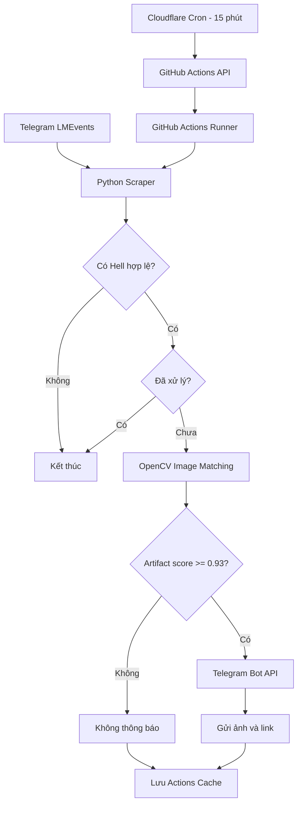

# 🔔 Hell Artifact Notification — Lords Mobile

Bot tự động theo dõi **Hell Event có nhiệm vụ Cổ Vật (Artifact)** trong Lords Mobile và gửi thông báo đến Telegram cá nhân.

Hệ thống sử dụng **Cloudflare Workers + GitHub Actions + Python + OpenCV + Telegram Bot API**. Ưu tiên miễn phí, bảo mật và không cần duy trì máy chủ riêng.

## 1. Mục tiêu

- Kiểm tra kênh Telegram `@LMEvents` mỗi 15 phút.
- Chỉ xử lý bài đăng có hashtag `#Hell`.
- Không quan tâm hashtag phần thưởng như `#Watcher`, `#BrilliantOrb`.
- Nhận diện biểu tượng nhiệm vụ Cổ Vật ở phía trên ảnh bằng OpenCV.
- Nếu đúng, gửi ảnh và link Hell Event vào Telegram.
- Chỉ kiểm tra Hell mới nhất còn hiệu lực, không quét lịch sử sự kiện.
- Hạn chế gửi thông báo trùng lặp.

## 2. System Architecture



### Tech Stack

| Công nghệ | Vai trò |
|---|---|
| Cloudflare Workers | Scheduler chạy mỗi 15 phút |
| GitHub Actions | Môi trường thực thi Python |
| Python 3.12 | Logic xử lý chính |
| Requests + BeautifulSoup | Đọc HTML công khai từ LMEvents |
| OpenCV + NumPy | Nhận diện biểu tượng Cổ Vật |
| GitHub Actions Cache | Chống xử lý trùng bài đăng |
| Telegram Bot API | Gửi thông báo |

## 3. Workflow chi tiết

### Bước 1 — Scheduling

Cloudflare Workers sử dụng Cron Trigger:

```cron
*/15 * * * *
```

Tương đương 96 mốc chạy mỗi ngày, vào phút 00, 15, 30 và 45 theo UTC.

Cloudflare gọi GitHub REST API bằng HTTP POST đến endpoint `workflow_dispatch` của `hell.yml`, truyền input `mode: live`.

### Bước 2 — GitHub Actions

GitHub khởi tạo runner Ubuntu, cài đặt Python và các thư viện cần thiết.

Chương trình chạy:

```bash
python bot.py inspect
```

### Bước 3 — Lấy Hell Event

Bot truy cập:

https://t.me/s/LMEvents

BeautifulSoup đọc các bài đăng và kiểm tra:

- Có hashtag `#Hell`.
- Có ảnh và thời điểm đăng hợp lệ.
- Bài đăng không quá 58 phút tuổi.

Bot chọn bài `#Hell` mới nhất thỏa điều kiện, không quét các bài cũ hơn.

### Bước 4 — Kiểm tra Cache

Bot dùng ID bài đăng để kiểm tra Actions Cache:

```text
hell-artifact-<post_id>
```

Nếu đã có cache, bỏ qua. Nếu chưa có, chuyển sang nhận diện ảnh.

### Bước 5 — Image Recognition

Bot tải ảnh Hell, chuẩn hóa kích thước về 500 × 249 pixel, rồi sử dụng OpenCV Template Matching để so sánh biểu tượng nhiệm vụ với `artifact_template.png`.

Ngưỡng nhận diện hiện tại:

```python
THRESHOLD = 0.93
```

- Score từ 0.93 trở lên: Xác định là Hell Cổ Vật.
- Score dưới 0.93: Không thông báo.

Không sử dụng AI API, OCR hay các dịch vụ nhận diện ảnh trả phí.

### Bước 6 — Telegram Notification

Nếu đạt ngưỡng, bot gọi Telegram Bot API `sendPhoto`, gửi ảnh sự kiện kèm link bài đăng gốc.

Ví dụ:

```text
🔔 HELL CỔ VẬT!
https://t.me/LMEvents/22403
```

ID trong ví dụ chỉ để minh họa định dạng liên kết.

## 4. Deployment

### GitHub

Repository: https://github.com/duykhoa1125/hell-artifact-notification

GitHub Secrets:

- `TELEGRAM_BOT_TOKEN`
- `TELEGRAM_CHAT_ID`

Workflow nằm tại:

```text
.github/workflows/hell.yml
```

Chỉ sử dụng `workflow_dispatch` để nhận lệnh từ Cloudflare hoặc chạy thủ công. GitHub Cron cũ đã được loại khỏi cấu hình được kiểm tra.

### Cloudflare Workers

- Tạo Worker `hell-artifact-scheduler`.
- Thêm GitHub fine-grained PAT dưới dạng Cloudflare Secret `GH_TOKEN`.
- PAT chỉ được truy cập repository này với quyền Actions cần thiết.
- Cấu hình Cron `*/15 * * * *`.
- Worker dùng GitHub REST API để kích hoạt workflow với mode `live`.

Mã Python chạy trên GitHub Actions, không chạy trên Cloudflare.

## 5. Security Design

Repository được đặt Public nhưng không công khai thông tin xác thực.

- Telegram Bot Token và Chat ID được lưu bằng GitHub Actions Secrets.
- GitHub PAT được lưu riêng bằng Cloudflare Secret.
- Không sử dụng Telegram session hoặc đăng nhập tài khoản Lords Mobile.
- GitHub workflow giới hạn `contents: read`.
- Không kích hoạt workflow từ Pull Request không tin cậy.
- Giới hạn nguồn tải ảnh và kích thước file.
- Không ghi token hoặc dữ liệu nhạy cảm ra logs.

Các token phải được thu hồi và thay mới nếu có dấu hiệu bị lộ.

## 6. Testing & Monitoring

### Image Test

```bash
python bot.py test-image --file tests/hell_sample_1.png
```

Hai ảnh mẫu Hell Cổ Vật ban đầu có độ khớp rất cao.

### Live Test

Trong GitHub Actions:

1. Chọn **Hell Artifact Notification**.
2. Chọn **Run workflow**.
3. Chọn chế độ `live`.
4. Kiểm tra logs.

Ví dụ log đã quan sát:

```text
Latest #Hell id=22403; icon score=0.546; threshold=0.93
Not Artifact Hell. No notification.
```

### Monitoring

- **Cloudflare Logs:** Kiểm tra lệnh gọi GitHub API.
- **GitHub Actions Logs:** Kiểm tra scraper, kết quả nhận diện và lỗi.
- **Telegram:** Xác minh thông báo đến thiết bị.

Dấu tích xanh của một GitHub job không có nghĩa bot đã gửi thông báo: việc không phát hiện Cổ Vật cũng là một kết quả hợp lệ.

**Lưu ý:** Ở phiên bản mã nguồn được kiểm tra, workflow gọi `test-notify` nhưng `bot.py` chưa hỗ trợ lệnh này. Chế độ Test cần được đồng bộ trước khi dùng.

## 7. Limitations

- Cloudflare Cron và GitHub Actions không bảo đảm lịch chạy chính xác tuyệt đối.
- Nếu nhiều Hell được đăng trước lần kiểm tra tiếp theo, bot có thể bỏ lỡ sự kiện cũ.
- Template Matching có thể không chính xác nếu giao diện hoặc kích thước ảnh thay đổi.
- Telegram có thể thay đổi cấu trúc HTML của trang public.
- GitHub Actions Cache có thể hết hạn hoặc bị xóa.
- GitHub Token có thời hạn và cần được gia hạn khi hết hạn.

## 8. Kết luận

Hệ thống sử dụng kiến trúc **Serverless Scheduler + On-Demand Processing**:

**Cloudflare Workers → GitHub Actions → Python/OpenCV → Telegram.**

Ưu điểm chính là chi phí dự kiến gần 0, không cần VPS, không cần bật PC, tận dụng hệ sinh thái GitHub và dễ bảo trì.

Thiết kế ưu tiên sự đơn giản, không hướng tới hệ thống giám sát thời gian thực có cam kết SLA.
